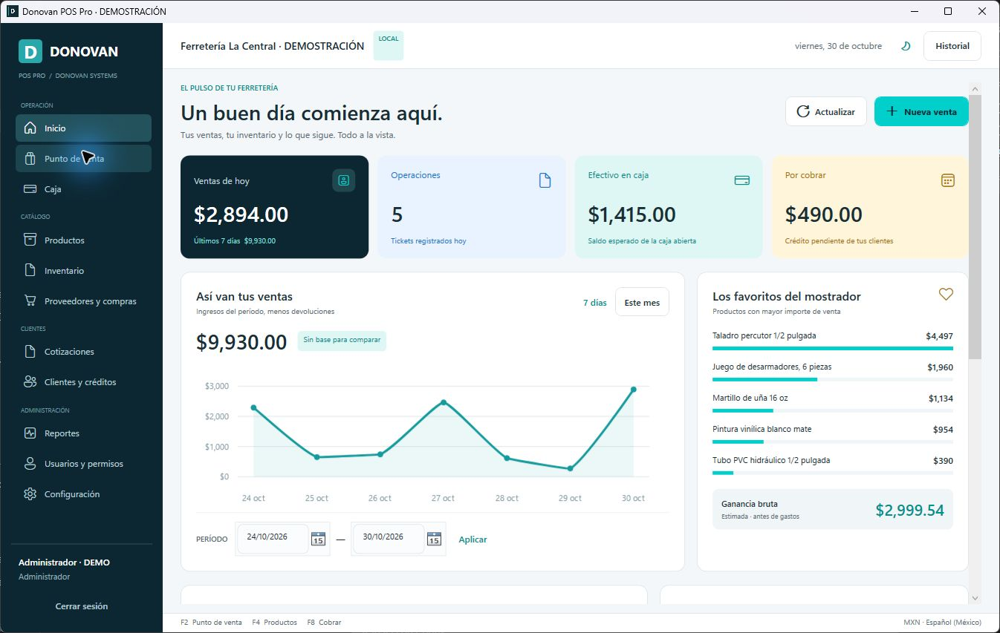
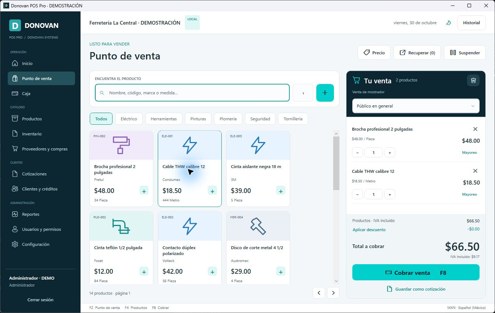

# Donovan POS Pro

Punto de venta de escritorio para ferretería, desarrollado para Windows por **Donovan Systems**. Autor del proyecto: **Ing. Edwin Donovan Castañeda Calderón**. Interfaz en español de México, moneda MXN y funcionamiento local sin conexión a Internet.

## Empezar

1. Instala `artifacts/DonovanPOS-1.0.0-win-x64.msi`, o descomprime `artifacts/DonovanPOS-1.0.0-portable.zip`.
2. Abre **Donovan POS Pro**. En el primer inicio, el asistente solicita los datos del negocio y la creación de tu administrador. No hay usuarios ni contraseñas predeterminadas.
3. Configura impresora, ancho de ticket, impuestos y carpeta de respaldos. Agrega productos o descarga la plantilla de importación.
4. Abre caja con el fondo inicial y registra tu primera venta.

Para explorar con datos ficticios, usa **Probar demostración** desde Inicio o `Probar demostracion.cmd` en el paquete portátil. La demostración crea una base temporal nueva en cada arranque, identificada como DEMOSTRACIÓN. No modifica los datos reales. La aplicación normal comienza vacía.

El paquete incluye el runtime .NET 10.0.14; no necesitas instalar Visual Studio, un SDK ni un servidor de base de datos. Requiere Windows 10 versión 2004 o posterior, o Windows 11, de 64 bits. El instalador es por usuario y permite cambiar la carpeta de destino. La desinstalación conserva la base del negocio.

## Funciones

- Dashboard con ventas reales, operaciones, efectivo, cartera, comparativas, productos vendidos, categorías y formas de pago; filtros de fechas y gráficos interactivos.
- Caja con catálogo visual, búsqueda por palabras, medidas, marca, alias y código; cantidades fraccionarias, mayoreo, descuentos, pagos mixtos y cambio.
- Ventas suspendidas persistentes, recuperación y comprobación de precios y existencias antes de cobrar.
- Productos, presentaciones y variantes con claves independientes; inventario, mínimos, sugerencia para llegar al mínimo, movimientos y recepción de compras.
- Clientes, límite de crédito, vencimientos, abonos, historial y devoluciones parciales o cancelación con motivo.
- Cotizaciones guardadas, PDF, vigencia y conversión a venta; no descuentan existencias mientras sean cotizaciones.
- Caja de efectivo: apertura, ingresos, egresos y corte con diferencia entre esperado y contado.
- Tickets de 58/80 mm con vista previa, cotizaciones y reportes PDF, etiquetas Code 128, importación y exportación Excel.
- Administrador y cajero, controles de permisos, bitácora, temas claro/oscuro, movimiento reducido, respaldo manual y automático, restauración validada y copia de seguridad previa.

Consulta [el manual de uso](docs/MANUAL.md), [la arquitectura](docs/ARQUITECTURA.md), [la validación](docs/VALIDACION.md) y [las licencias](docs/INVESTIGACION-Y-LICENCIAS.md).

Capturas del ejecutable autónomo, con datos de demostración:





## Datos y respaldos

La base real se guarda en `%LOCALAPPDATA%\DonovanSystems\DonovanPOS\data`. Las copias automáticas se ejecutan mientras el programa está abierto, al cumplirse el intervalo configurado; no se instala un servicio en segundo plano. La configuración inicial propone una carpeta local que puedes cambiar por un disco externo. Una copia en el mismo disco no protege frente a la pérdida de ese disco.

Los datos de demostración se guardan por separado en `%TEMP%\DonovanPOS-Demo\<identificador>`. El cierre de una demostración no elimina automáticamente su carpeta; Windows puede limpiar sus archivos temporales. Para pruebas independientes puede usarse `DonovanPOS.exe --data-dir "C:\MiCarpetaDePrueba"`. No apuntes varias computadoras al mismo archivo SQLite ni a una carpeta sincronizada en uso.

## Desarrollo y publicación

Con .NET SDK 10 en Windows y PowerShell 7:

```powershell
dotnet restore DonovanPOS.sln
dotnet build DonovanPOS.sln -c Release
dotnet test tests/DonovanPOS.Tests -c Release
dotnet run --project src/DonovanPOS.Presentation
./scripts/Publish.ps1 -Installer
```

`Publish.ps1` ejecuta las pruebas, crea una aplicación autónoma x64, incorpora manuales y licencias, genera ZIP/MSI y escribe `artifacts/SHA256SUMS.txt`. `Build-Installer.ps1` utiliza Windows Installer y `makecab.exe` del sistema: no requiere un compilador de instaladores externo. Incrementa la versión de producto y ensamblados al preparar una actualización; el UpgradeCode permanece estable.

La auditoría visual de desarrollo se puede repetir con:

```powershell
dotnet run --project src/DonovanPOS.Presentation -- --qa --qa-audit artifacts/qa
```

Este comando usa datos temporales, genera vistas WPF y documentos de prueba, y detecta errores de enlaces y de interfaz. Solo está disponible en Debug. El modo `--demo` también está disponible en Release.

## Alcance de esta entrega

Se trata de una aplicación local para una caja/base por instalación. Tarjeta y transferencia registran la forma de pago; no conectan con un banco o una terminal. Los comprobantes no son CFDI. No se implementan timbrado SAT, nube, sincronización entre sucursales, tienda en línea ni hardware fiscal. El formato de código de barras es Code 128; los escáneres USB deben operar como teclado.

Las pruebas funcionales y visuales se documentan con sus límites. La impresión física, la lectura con un escáner real y los cambios reales de DPI de Windows requieren validación en el equipo del negocio. Los binarios locales no tienen firma Authenticode ni certificado de editor: el nombre del autor en los metadatos no sustituye esa firma.
