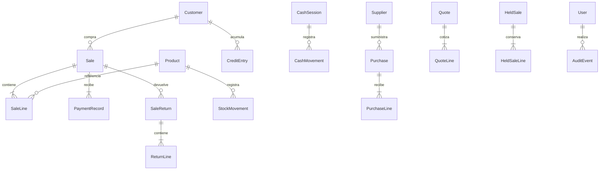

# Arquitectura y mantenimiento

## Capas

| Proyecto | Responsabilidad | Dependencias propias |
|---|---|---|
| Domain | Entidades, dinero, cantidades, invariantes, motor de precios | Ninguna |
| Application | Casos de uso, permisos y contratos de persistencia/documentos | Domain |
| Infrastructure | SQLite/EF, consultas FTS5, reportes, archivos, PDF, Excel y respaldos | Application y Domain |
| Presentation | WPF, MVVM, navegación, temas, diálogos y composición de servicios | Application, Domain; Infrastructure en el arranque |
| Tests | Integración sobre SQLite temporal y reglas de negocio | Capas no visuales |

`App.xaml.cs` es la raíz de composición. Los ViewModels invocan casos de uso; no ejecutan SQL ni escriben PDF. Las vistas enlazan comandos y estado. Los servicios trabajan mediante `IDataStore`/`IDataSession`; las consultas de búsqueda y de reportes especializadas evitan cargar el catálogo completo para cada interacción. `IDocumentService`, `IBackupService`, `IProductQueries`, `IReportingService` e `IClock` delimitan infraestructura sustituible.

Las vistas principales nuevas son OverviewView, RegisterView, StockView y WelcomeView. Los recursos compartidos de Themes definen superficies, colores, foco, estados, botones, campos, tablas y navegación. Los iconos de categorías y el monograma son vectores propios. Los gráficos utilizan LiveCharts2/SkiaSharp. El modo oscuro no depende de invertir imágenes.

## Integridad de las operaciones

Los importes persistidos usan enteros de 64 bits en centavos. Los cálculos intermedios usan decimal; las cantidades se almacenan en unidades enteras escaladas por 10,000. No se usa double para precios ni saldos. Solo gráficos y la representación numérica del archivo Excel emplean double.

Venta, pagos, existencias, movimientos de caja, deuda y folio se confirman en una transacción. Un identificador de solicitud único hace idempotente el cobro. La validación final consulta existencias y permisos dentro de la operación. La base tiene restricciones e índices únicos para claves, códigos, solicitudes, folios y una sola caja abierta. No se depende de que un botón esté deshabilitado para mantener la integridad.

Un semáforo de base serializa accesos dentro del proceso y coordina respaldos/restauraciones. Cada operación utiliza su propio DbContext; los trabajos de disco/SQL se ejecutan fuera del hilo visual. SQLite usa WAL, relaciones activas, sincronización FULL y conexiones sin pooling para permitir restaurar de forma controlada. Un mutex por ruta impide abrir dos instancias de esta aplicación sobre la misma carpeta. Estos mecanismos no convierten SQLite en un servidor de red ni en una solución multisucursal.

El descuento y el IVA se distribuyen entre partidas por restos mayores, conservando exactamente el total en centavos. Las devoluciones calculan el acumulado devuelto y restan lo ya reintegrado para impedir pérdidas por redondeos sucesivos. En una devolución a crédito primero se amortiza la deuda pendiente. Los datos de una venta son instantáneas: cambiar el producto no reescribe el historial.

Las cotizaciones y suspendidas son estados distintos. Cotizar o suspender no mueve stock ni caja. La cotización mantiene condiciones acordadas y vigencia; la suspendida conserva un carrito recuperable y avisa sobre diferencias. La venta final vincula y consume el documento correspondiente en su transacción.

## Persistencia y relaciones

El diagrama expresa relaciones de negocio; los nombres exactos de clases/tablas se encuentran en Domain y `PosDbContext`. Se conservan todas las migraciones: esquema inicial, campos e índice de búsqueda, suspendidas y respaldo/logotipo. La aplicación usa `Migrate`, no `EnsureDeleted` ni recreación destructiva. Antes de actualizar una base existente con migraciones pendientes crea una copia verificable. Restaurar una copia de una versión futura se rechaza.

La búsqueda usa FTS5 con `unicode61 remove_diacritics 2`, términos prefijados combinados con AND y parámetros SQL. Nombre, marca, categoría, medidas, alias, SKU y código quedan indexados. Los triggers mantienen el índice al insertar, editar o archivar. SKU/código exactos conservan prioridad. Los resultados son paginados; la entrada se limita a 200 caracteres y doce términos. La prueba con 2,000 productos comprueba varias páginas y tiempo de consulta sin fijar una promesa universal de rendimiento.

## Identidad, permisos y auditoría

Las contraseñas se guardan con PBKDF2-SHA256, sal aleatoria y 600,000 iteraciones, con comparación de tiempo constante. No existen credenciales de producción predeterminadas. Los servicios exigen permisos; el administrador y cajero tienen capacidades distintas. Se protege la permanencia de un administrador activo. Hay bloqueo temporal tras intentos fallidos.

La bitácora documenta cambios de precio, ajustes, cobros, cancelaciones, caja y restauraciones. Los logs técnicos registran tipo de excepción y traza, evitando volcar contraseñas o parámetros completos de las operaciones. SQLite y los respaldos no están cifrados; su protección física y los permisos de Windows forman parte de la operación local.

## Respaldo y documentos

El respaldo usa la API de SQLite para incorporar correctamente WAL; escribe un archivo temporal, verifica integridad y claves externas y lo renombra al terminar. Registra hash SHA-256, tamaño y resultado. Antes de sustituir la base, la restauración prepara y valida una copia, aplica migraciones conocidas y conserva una copia de la base vigente. No hay limpieza automática de respaldos.

El logotipo se incorpora a StoreSettings como bytes, evitando depender de una ruta externa después de restaurar. PDFsharp 6.2.4 crea tickets, cotizaciones y reportes; ZXing codifica Code 128 que se dibuja como barras vectoriales. Los tickets fijan su geometría antes de crear el contexto gráfico. Las tablas y textos se paginan; las palabras se ajustan al ancho disponible. La impresión física utiliza FlowDocument, vista previa y PrintDialog de Windows.

ClosedXML genera los archivos Excel y valida importaciones con límites de tamaño, filas, expansión ZIP y fórmulas. El importador valida el conjunto antes de una confirmación transaccional y copia las entidades de la vista previa para permitir reintentar sin estado contaminado después de un error.

## Evolución

Para añadir capacidades, crea un caso de uso y su contrato, implementa infraestructura y añade el ViewModel/vista. No coloques cálculos fiscales o de inventario en code-behind. Toda modificación del modelo persistente requiere una nueva migración y una prueba de actualización desde una base anterior.

Multisucursal, sincronización, facturación CFDI, integración bancaria, órdenes de compra y servicio de respaldo con la app cerrada son desarrollos futuros, no opciones activas. Un servidor multiusuario exigiría reemplazar la persistencia local, definir concurrencia y autorización de servidor, y probar conflictos y desconexión; no basta con compartir el archivo SQLite.
