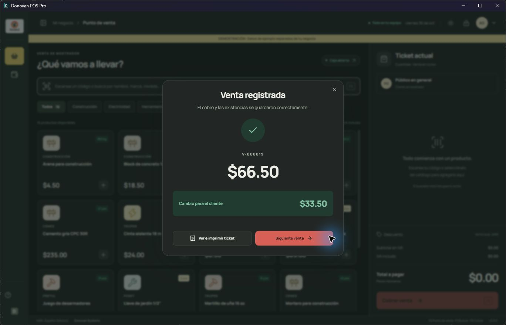

# Reconstrucción 2.0 — registro de validación

La versión 1.0 WPF y sus pruebas permanecen en el repositorio como referencia funcional. La nueva aplicación vive en `desktop` y usa Tauri 2, React, TypeScript y servicios Rust con SQLite. Este archivo registra hitos comprobados; no representa una declaración de entrega final.

## Primer flujo completo (30 de octubre de 2026)

- El motor Rust conserva el esquema de negocio 1.0, importes en centavos y cantidades escaladas por 10,000.
- La migración 2 añade sesiones, preferencias del tutorial y recibos de operación; no sustituye los historiales.
- Prueba automatizada: venta de 2.5 metros a $18.50, total $46.25, cambio $3.75, reinicio conservando venta y sesión. Reintentar con la misma referencia no duplica cobro ni inventario.
- Prueba desde la ventana Tauri con recursos incluidos (sin servidor de desarrollo): brocha $48.00 y cable $18.50; F8, efectivo $100.00, venta V-000019 por $66.50 y cambio $33.50.
- Verificación posterior de SQLite: 19 ventas (18 de muestra más la nueva), brochas 31 piezas, cable 446 metros, `integrity_check=ok`.
- Demostración aislada en `%TEMP%/DonovanPOS2-Demo`; nunca se utilizaron datos productivos.
- El logotipo original se copia sin modificaciones. El nombre y colores iniciales se leen desde `assets/branding/customer-profile.json` y se convierten en configuración editable del negocio.

La migración de módulos adicionales, la prueba A/B de restauración y la validación final del instalador continúan después de este hito.
